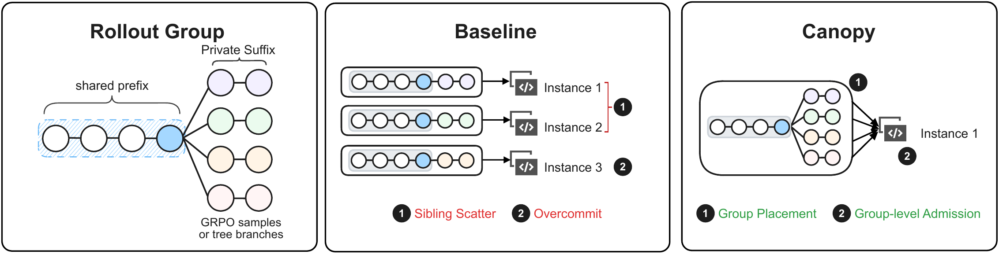
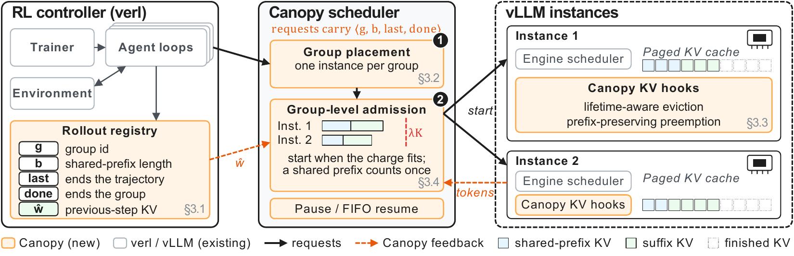
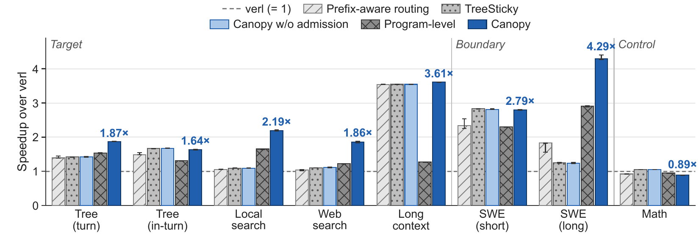

<div align="center">

# Canopy: Tree-Aware Rollout Scheduling for Agent Reinforcement Learning

**NeurIPS 2026**

Feiyuan Zhang<sup>1</sup>, Pengbo Li<sup>1</sup>, Ziniu Li<sup>2</sup>, Yuhao Jiang<sup>2</sup>, Di Chai<sup>3</sup>, Han Tian<sup>1</sup>,
Junhao Wang<sup>4</sup>, Taiqiang Wu<sup>5</sup>, Guanhua Huang<sup>2</sup>, Chaoliang Zeng<sup>1</sup>, Yihao Liu<sup>2</sup>, Kai Chen<sup>1</sup>

<sup>1</sup>The Hong Kong University of Science and Technology &nbsp; <sup>2</sup>Tencent &nbsp;
<sup>3</sup>Shanghai University of Finance and Economics &nbsp; <sup>4</sup>The Chinese University of Hong Kong &nbsp;
<sup>5</sup>The University of Hong Kong

[](LICENSE)
[](https://github.com/vllm-project/vllm)
[](integrations/verl)
[](pyproject.toml)

</div>

RL frameworks send each turn of an agent rollout to the serving stack as an independent
request, so the stack computes a shared prefix on several instances and recomputes
histories it evicted while their trajectories waited for tools; on our workloads, verl
computes 2.5–7.9× the minimum prefill. Canopy schedules these requests with what the RL
controller already knows: which trajectories share a prefix, when they end, and how much
memory the previous step needed. It makes the group of trajectories that share a prefix the
unit of placement and memory accounting, and it runs on stock vLLM.

<p align="center">
  
</p>

## Highlights

- **1.6–3.6× faster rollout steps than verl** on five tree-rollout, search, and
  long-context workloads (geometric mean 2.14×), and 1.2–2.8× faster than program-level
  scheduling (a re-implementation of ThunderAgent's policy). The steps are synthetic,
  modeled on Qwen3-8B agent trajectories, and replayed under every policy on the same vLLM
  engine.
- **1.6–2.3× faster than verl on long-horizon trajectories that branch late**:
  64k–122k-token trajectories that fork into 4–16 branches after many turns.
- **Few preemptions:** with group-level admission the engines preempt at most once per
  run, against 14–82 times under verl.
- **Same computation:** Canopy changes where and when requests run and which KV blocks
  stay cached, not what they compute. In 300-step ARPO training, its placement and
  retention had no detectable effect on learning.

## How Canopy works

<p align="center">
  
</p>

The RL controller attaches a descriptor ⟨*g*, *b*, *last*, *done*⟩ to every request: the
group id, the length of the prefix shared within the group, whether the trajectory sends
no further request, and whether no request of the group remains.

1. **Group placement.** A group's first trajectory goes to the instance with the lowest
   memory charge relative to its capacity, and the rest of the group follows it, so
   siblings reuse one cached copy of the shared prefix.
2. **Group-level admission.** A trajectory starts or resumes only when its instance can
   hold it. The group's shared prefix is counted once, and each trajectory is charged at
   least *ŵ*, the previous step's peak private KV per trajectory. When an instance is over
   capacity, its tool-waiting trajectories are paused, largest first, and resumed when
   memory frees up.
3. **Retention.** Hooks in the vLLM engine evict the blocks of finished trajectories
   first. Two further mechanisms can be turned on: shared-prefix references, which make
   the shared prefix of a live group the last thing evicted, and prefix-preserving
   preemption, which keeps the shared prefix of a preempted request. They are off in the
   paper's main runs, where placement and admission produce the gains.

## Results

<p align="center">
  
</p>

Speedup of a rollout step over verl, with Qwen3-8B on eight H20 GPUs and one vLLM instance
per GPU (median and range of three runs). The SWE-style workloads are boundary cases, in
which trajectories mostly reuse their own history. Math reasoning is a control: its input
is small next to its output, and Canopy is 13% slower than verl there.

On long trajectories that branch late (four instances):

| Trajectory | Branches | Shared prefix | verl, rollout time | TreeSticky, speedup | Canopy, speedup |
|---:|---:|---:|---:|---:|---:|
| 94k | 4 | 79k (85%) | 1363 s | 1.80× | **1.93×** |
| 95k | 4 | 46k (49%) | 1568 s | 1.59× | **2.33×** |
| 95k | 4 | 30k (32%) | 1877 s | 1.34× | **2.32×** |
| 98k | 8 | 93k (95%) | 1465 s | **1.63×** | 1.62× |
| 94k | 8 | 70k (75%) | 1681 s | 1.78× | **2.07×** |
| 122k | 8 | 103k (84%) | 1887 s | 1.92× | **2.08×** |

TreeSticky only keeps each group on one instance. Here Canopy charges each request its own
*b* (`canopy_fx`); with the charge of the main runs (`canopy`), it is 1.5–2.1× faster than
verl. Placement gives most of the gain when the shared prefix is long, and admission when it
is short.

## What is in this repository

- [`canopy/engine`](canopy/engine): hooks for the vLLM V1 engine that implement retention
  (and the time-to-live baseline). They act on the descriptor each request carries;
  placement and admission are not part of the hooks.
- [`canopy/bench`](canopy/bench): the rollout-replay driver. It generates rollout steps
  from a seed, starts vLLM servers with the hooks, and implements group placement,
  group-level admission, and the baselines of the paper. The scheduler is part of this
  driver; it is not packaged as a standalone library.
- [`integrations/verl`](integrations/verl): an earlier integration into
  [verl](https://github.com/volcengine/verl), used for the paper's training runs. It
  implements group placement and retention, without admission.
- [`configs`](configs), [`scripts`](scripts), [`docs/REPRODUCE.md`](docs/REPRODUCE.md): the
  configurations of the paper's serving experiments, the scripts that run and summarize
  them, and the guide to reproducing each figure and table.

## Installation

Python 3.10 or newer and NVIDIA GPUs.

```bash
git clone https://github.com/FarrenZhang/canopy-rl.git
cd canopy-rl
pip install -e ".[vllm,orjson]"      # vLLM 0.20.x
```

`ray` (`pip install -e ".[ray]"`) is needed only for multi-node experiments. The CPU tests
need only `pytest`: `python -m pytest tests`, and for the verl integration
`cd integrations/verl && python -m pytest canopy_verl/tests`.

## Quick start

Replay a small tree-search step on one GPU under verl's routing (`vanilla`), TreeSticky
(`sticky`), Canopy without admission (`rv`), and Canopy (`canopy`):

```bash
python -m canopy.bench.runner --exp quickstart --model Qwen/Qwen3-8B --gpus 0 \
    --workload '{"kind": "tree", "groups": 4, "n": 16, "fanout": 4, "branch_at": 2, "turns": 6,
                 "prefix": [300, 600], "obs": [600, 1500], "gen": [100, 400], "tool_ms": [200, 1500]}' \
    --policies vanilla,sticky,rv,canopy --repeats 1
python scripts/analyze.py quickstart
```

The runner starts one vLLM server with the hooks loaded, builds 4 trees of 16 leaves, replays
the step once per policy, and writes `results/quickstart/results.json`; `analyze.py` prints
the rollout time of each policy and its speedup over `vanilla`. This small step checks the
setup; on one GPU there is nothing to place, so it is not meant to show Canopy's gains. To
see the effect of admission on one GPU, run `python scripts/run_experiment.py sc_conc_c256`
(256 trajectories, more than one GPU's KV memory holds; Figure 8c of the paper).

## Using the engine hooks

Start a vLLM server with the hooks and send the descriptor with each request:

```bash
export PYTHONPATH="$(python -c 'import canopy.engine as e; print(e.HOOKS_DIR)')${PYTHONPATH:+:$PYTHONPATH}"
CANOPY_ENGINE_HOOKS=1 vllm serve Qwen/Qwen3-8B --enable-prefix-caching --port 8000

curl -s http://127.0.0.1:8000/v1/completions -H 'Content-Type: application/json' -d '{
  "model": "Qwen/Qwen3-8B", "prompt": "<shared prompt> <trajectory-specific text>", "max_tokens": 128,
  "vllm_xargs": {"canopy_mode": "lifetime", "canopy_shared_len": 512,
                 "canopy_terminal": 0, "canopy_group_done": 0}}'
```

These are the keys that the paper's main runs send. The server log shows
`[canopy] patched vllm.v1.core.sched.scheduler ...` once per process when the hooks are
active. The descriptor travels in `vllm_xargs` of the OpenAI-compatible completions API,
which vLLM passes on as `SamplingParams.extra_args`:

| Key | Meaning | Default |
|---|---|---|
| `canopy_mode` | `"lifetime"` (Canopy) or `"ttl"` (time-to-live baseline); without it the hooks ignore the request | none |
| `canopy_shared_len` | *b*: length of the prefix shared within the group, in tokens | 0 |
| `canopy_terminal` | *last*: the trajectory sends no further request | 0 |
| `canopy_group_done` | *done*: no request of the group remains | 0 |
| `canopy_group` | *g*: group id, needed by `canopy_pin` | none |
| `canopy_pin` | shared-prefix reference: keep the shared prefix of a live group out of the eviction queue | 0 |
| `canopy_pp` | prefix-preserving preemption: keep the shared prefix of a preempted request | 0 |
| `canopy_pin_mode` | `"evict"` (references yield to any allocation) or `"admit"` (strict: they yield only to running requests) | `"evict"` |
| `canopy_pin_ttl` | seconds; `lifetime` mode: safety timeout of a reference; `ttl` mode: how long a finished request's blocks are held | 60 in `lifetime` mode; 0 (no hold) in `ttl` mode |
| `canopy_traj` | trajectory id; in `ttl` mode the trajectory's next turn releases the hold | none |

The hooks implement only retention, which changes rollout time little on its own; the
speedups come from placement and admission, which the replay driver implements
(`canopy/bench/runner.py`). A request without these keys is served exactly as by stock
vLLM. References are soft: when an allocation fails, they are released, least recently
touched first, and the allocation is retried.

The hooks wrap six functions of vLLM V1: `SingleTypeKVCacheManager.free`,
`KVCacheManager.allocate_slots`, and the `Scheduler`'s `_free_blocks`, `schedule`,
`_preempt_request`, and `reset_prefix_cache`. They load in every process of a server through
`canopy/engine/sitecustomize.py` when that directory is on `PYTHONPATH` and
`CANOPY_ENGINE_HOOKS=1`; a `sitecustomize.py` on `PYTHONPATH` replaces any other
`sitecustomize` module of the environment. In-process, `canopy.engine.vllm_hooks.install()`
does the same. If `CANOPY_ENGINE_STATS_DIR` is set, every engine process writes its hook
counters there as JSON.

## Reproducing the paper

[`docs/REPRODUCE.md`](docs/REPRODUCE.md) lists, for every figure and table of the paper's
serving evaluation, the experiments to run, the GPUs they need, and the script that prints
the numbers. In short:

```bash
python scripts/run_experiment.py --list        # the paper's experiments
python scripts/run_experiment.py 'm_*'         # Figure 6: 16 jobs of 8 GPUs
python scripts/analyze.py m_                   # rollout times and speedups (Table 5)
```

The paper's measurements used NVIDIA H20 GPUs and vLLM 0.20.1. The training runs use the
verl integration; see its [README](integrations/verl/README.md).

## Limitations

The rollout steps are synthetic: their length ranges were set by hand from small samples,
output lengths are known to the scheduler, and the previous-step estimate comes from a
second sample of the workload rather than from a changing policy. Admission is not in the
verl integration or the training runs, so RL step time with admission was not measured.
The baselines are re-implementations in the same driver. The main results use one node,
one engine, and one GPU type, with synchronous rollout. Canopy does not help when inputs are
small next to outputs, as in math reasoning.

## Citation

```bibtex
@inproceedings{zhang2026canopy,
  title     = {Canopy: Tree-Aware Rollout Scheduling for Agent Reinforcement Learning},
  author    = {Zhang, Feiyuan and Li, Pengbo and Li, Ziniu and Jiang, Yuhao and Chai, Di and
               Tian, Han and Wang, Junhao and Wu, Taiqiang and Huang, Guanhua and Zeng, Chaoliang and
               Liu, Yihao and Chen, Kai},
  booktitle = {Advances in Neural Information Processing Systems (NeurIPS)},
  year      = {2026}
}
```

## License

Apache License 2.0; see [LICENSE](LICENSE). [NOTICE](NOTICE) lists the parts that derive
from or patch vLLM and verl, and the scheduler re-implemented from ThunderAgent.
